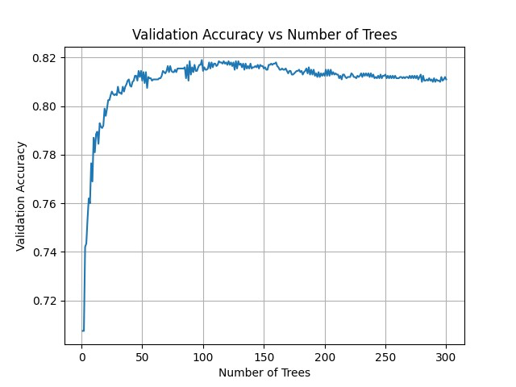

# Tree Ensembles from Scratch

Decision trees, bagging, random forests, AdaBoost and gradient boosting written from scratch in NumPy, with no ML libraries for the models. Tested on MNIST and Fashion-MNIST.

Done as part of the Statistical Machine Learning course at IIIT-Delhi (Jan–Apr 2026).

## What's in here

| File | Dataset | What it does |
|---|---|---|
| `decision_tree_bagging_rf.py` | MNIST digits 0, 1, 2 (PCA → 10 dims) | Gini decision tree with 3 leaves, bagging with out-of-bag error, and a random forest picking 3 random features per split |
| `regression_stump_bagging.py` | Fashion-MNIST classes 0, 1, 2 (PCA → 10 dims) | Regression stump chosen by minimising sum of squared residuals, plus bagging with OOB MSE |
| `adaboost.py` | MNIST 4 vs 9 (PCA → 5 dims) | AdaBoost with decision stumps, 300 rounds, best number of rounds picked on a validation set |
| `gradient_boosting.py` | MNIST 4 vs 9 (PCA → 5 dims) | Gradient boosting with regression stumps on squared loss, with a learning-rate sweep (0.001 to 1) |

PCA is always fit on the training data only and then applied to validation/test.

## Results

**Decision tree vs bagging vs random forest (MNIST 0/1/2)**

| Model | Test accuracy | Digit 0 | Digit 1 | Digit 2 |
|---|---|---|---|---|
| Single tree | 80.9% | 99.1% | 90.3% | 53.3% |
| Bagging (5 trees) | 81.0% | 99.1% | 90.4% | 53.4% |
| Random forest (5 trees, k = 3) | **83.1%** | 81.9% | 76.0% | **92.0%** |

Bagging barely helps because the base tree is very shallow, so its problem is bias, and bagging mostly reduces variance. Random feature selection gives the forest more varied trees, which fixes digit 2 (53% → 92%) at some cost to digits 0 and 1.

**AdaBoost (MNIST 4 vs 9)**

- Best number of rounds on validation: 99
- Validation accuracy: 81.9%, test accuracy: **82.2%**
- Accuracy climbs fast in the first ~50 rounds, peaks around 100, then slowly drops, so picking the stopping point on validation matters.



**Regression stump vs bagging (Fashion-MNIST)**

| Model | Test MSE |
|---|---|
| Single stump | 0.358 |
| Bagging (5 stumps) | 0.351 |

Average OOB MSE for bagging is 0.351. The gain is small for the same reason as above: a single split is a high-bias model.

**Gradient boosting (MNIST 4 vs 9)**

Run `gradient_boosting.py` to get the validation-MSE curves for each learning rate (saved to `results/`). Small learning rates need many more trees to reach the same error, while large ones get there in a few trees but are noisier.

## Limitations

These are small models on purpose (course assignment): the classification trees have 3 leaves, ensembles use 5 trees, split thresholds in the classification tree are the feature mean, and the data is reduced to 5–10 PCA dimensions. The point was to implement and compare the methods, not to chase accuracy.

## How to run

```bash
pip install -r requirements.txt
# put the datasets in data/ (see data/README.md)
python decision_tree_bagging_rf.py
python regression_stump_bagging.py
python adaboost.py
python gradient_boosting.py
```

Plots are saved to `results/`.
